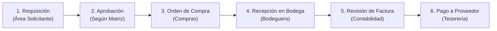
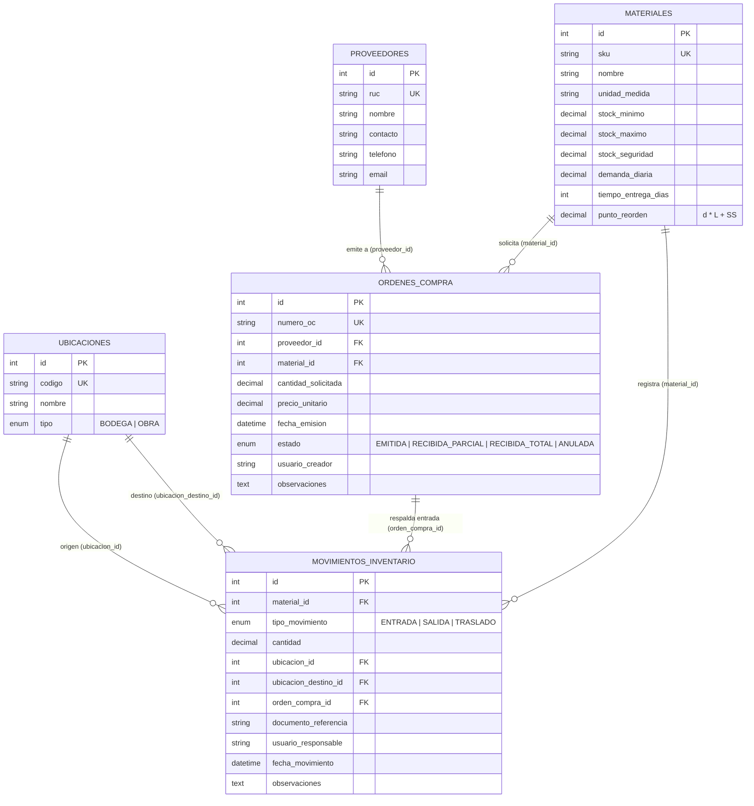

# Informe Técnico: Gestión de Inventarios y Análisis de Compras
**Constructora Del Valle S.A.**  
**Quiz #2 · Trabajo Práctico**

---

## Parte A: Análisis de Compras e Inventario (40 puntos)

### Ejercicio A1. El circuito de compra y la matriz de aprobación (8 pts)

#### a) Circuito completo de una compra (Requisición → Pago)

| Etapa | Responsable (Quién ejecuta) | Documento Generado | Control Interno Aplicado |
| :--- | :--- | :--- | :--- |
| **1. Requisición** | Ingeniero Residente / Jefe de Mantenimiento / Encargado de Bodega | Solicitud / Requisición de Compra (`RC`) | Verificación de stock existente en bodega antes de pedir, código SKU estandarizado y partida presupuestaria de la obra. |
| **2. Aprobación** | Jefatura del Área / Jefatura de Compras / Gerencia Financiera / Gerencia General | Requisición Aprobada + Cuadro Comparativo de Cotizaciones | Validación de umbrales de autorización según monto total y verificación del número mínimo de cotizaciones exigidas. |
| **3. Orden de Compra** | Departamento de Compras | Orden de Compra (`OC`) | Validación de proveedor autorizado, verificación de precios de contrato vigente y control anti-duplicados (mismo proveedor, material, cantidad y fecha cercana). |
| **4. Recepción** | Bodeguero Central o Bodeguero de Obra | Entrada de Almacén / Nota de Recepción (`NR`) y registro en Kardex | Conteo físico a ciegas e inspección de calidad contra la `OC` (cantidad recibida $\le$ cantidad solicitada en `OC`). |
| **5. Facturación** | Contabilidad / Cuentas por Pagar | Registro de Factura Electrónica (`FE`) y Validación *Three-Way Match* | **Three-Way Match (Triple Cruce)**: conciliación exacta entre **Orden de Compra** (precio y cantidad autorizada), **Nota de Recepción** (cantidad realmente ingresada a bodega) y **Factura** (monto cobrado por el proveedor). |
| **6. Pago** | Tesorería / Finanzas | Comprobante de Transferencia / Pago (`CP`) | Segregación de funciones (quien compra o recibe no puede liberar pagos), aplicación de descuentos pronto pago y cierre de la `OC` como pagada. |

---

#### b) Análisis de la matriz de aprobación y riesgo de fraccionamiento (*split orders*)

- **Riesgo de fraccionamiento de compras**: Si un solicitante necesita comprar ₡900 000 en materiales y lo divide en **4 órdenes de ₡225 000**, todas quedarían por debajo del primer umbral (hasta ₡250 000). Esto genera tres problemas graves:
  1. **Evasión del control jerárquico**: La Jefatura del área aprueba su propio gasto sin pasar por la Jefatura de Compras.
  2. **Evasión de competencia**: Solo se exige 1 cotización en vez de 2 o 3, facilitando el direccionamiento a un proveedor específico con sobreprecio.
  3. **Pérdida de poder de negociación por volumen**: Se compra al menudeo en lugar de consolidar el lote completo.

- **Mejoras propuestas a la matriz**:
  1. **Control de acumulado por proveedor/categoría en ventana móvil de 7 a 15 días**: El sistema suma todas las requisiciones del mismo artículo o hacia el mismo proveedor dentro de los últimos 15 días; si la suma supera ₡250 000, escala automáticamente al nivel de aprobación correspondiente.
  2. **Bloqueo automático de órdenes similares cercanas**: Alerta y retención automática cuando se emiten dos órdenes al mismo proveedor por el mismo insumo en menos de 72 horas.
  3. **Segregación entre solicitante y aprobador**: Ningún usuario que crea la requisición puede ser el único aprobador, incluso en montos menores a ₡250 000.

---

### Ejercicio A2. Clasificación de categorías de gasto (8 pts)

#### a) Taxonomía de dos niveles (`Categoría › Subcategoría`) y reclasificación de las 8 líneas

| Línea ERP | Descripción Original en ERP | Área | Proveedor | Cant. | Precio Unit. | Código Estándar (SKU) | Nombre Estandarizado | Categoría › Subcategoría |
| :---: | :--- | :--- | :--- | :---: | :---: | :---: | :--- | :--- |
| **1** | Cemento gris 50 kg | Obras | Proveedor A | 200 | ₡6 450 | `MAT-CEM-050` | Cemento gris uso general 50 kg | Materiales de Construcción › Cemento y Agregados |
| **2** | Saco cemento uso general | Mantenimiento | Proveedor B | 40 | ₡7 100 | `MAT-CEM-050` | Cemento gris uso general 50 kg | Materiales de Construcción › Cemento y Agregados |
| **3** | CEM-GRIS-50 | Bodega Central | Proveedor A | 300 | ₡6 300 | `MAT-CEM-050` | Cemento gris uso general 50 kg | Materiales de Construcción › Cemento y Agregados |
| **4** | Varilla #3 grado 40 | Obras | Proveedor C | 500 | ₡2 150 | `MAT-VAR-003` | Varilla corrugada #3 (3/8" x 6m) G40 | Materiales de Construcción › Acero de Refuerzo |
| **5** | Hierro 3/8 x 6 m | Mantenimiento | Proveedor D | 60 | ₡2 600 | `MAT-VAR-003` | Varilla corrugada #3 (3/8" x 6m) G40 | Materiales de Construcción › Acero de Refuerzo |
| **6** | Guantes de nitrilo talla L | Bodega Central | Proveedor E | 100 | ₡850 | `EPP-GUA-L` | Guantes de protección talla L | Seguridad Industrial (EPP) › Protección Manual |
| **7** | Guantes trabajo L | Obras | Proveedor F | 80 | ₡1 200 | `EPP-GUA-L` | Guantes de protección talla L | Seguridad Industrial (EPP) › Protección Manual |
| **8** | Tubo PVC 1/2 SDR 13.5 | Mantenimiento | Proveedor B | 25 | ₡2 900 | `HID-TUB-012` | Tubo PVC 1/2" SDR 13.5 | Materiales Hidrosanitarios › Tubería PVC |

**Agrupación de insumos equivalentes:**
- **Insumo 1 (`MAT-CEM-050`)**: Líneas **1, 2 y 3** corresponden al mismo saco de cemento gris de 50 kg (total: $200 + 40 + 300 = 540\text{ sacos}$).
- **Insumo 2 (`MAT-VAR-003`)**: Líneas **4 y 5** corresponden a la misma varilla #3 de 3/8" $\times$ 6 m (total: $500 + 60 = 560\text{ varillas}$).
- **Insumo 3 (`EPP-GUA-L`)**: Líneas **6 y 7** corresponden a guantes de trabajo talla L (total: $100 + 80 = 180\text{ pares}$).
- **Insumo 4 (`HID-TUB-012`)**: Línea **8** (Tubo PVC 1/2" SDR 13.5).

---

#### b) Cálculo del ahorro en Cemento y Varilla comprando al menor precio observado

1. **Cemento Gris 50 kg (`MAT-CEM-050`) — Menor precio observado: ₡6 300 (Línea 3)**
   - Línea 1 (Obras): $200 \times (\text{₡}6\,450 - \text{₡}6\,300) = 200 \times \text{₡}150 = \text{₡}30\,000$
   - Línea 2 (Mantenimiento): $40 \times (\text{₡}7\,100 - \text{₡}6\,300) = 40 \times \text{₡}800 = \text{₡}32\,000$
   - Línea 3 (Bodega Central): $300 \times (\text{₡}6\,300 - \text{₡}6\,300) = \text{₡}0$
   - **Ahorro en Cemento**: $\text{₡}30\,000 + \text{₡}32\,000 = \mathbf{\text{₡}62\,000}$

2. **Varilla #3 (`MAT-VAR-003`) — Menor precio observado: ₡2 150 (Línea 4)**
   - Línea 4 (Obras): $500 \times (\text{₡}2\,150 - \text{₡}2\,150) = \text{₡}0$
   - Línea 5 (Mantenimiento): $60 \times (\text{₡}2\,600 - \text{₡}2\,150) = 60 \times \text{₡}450 = \text{₡}27\,000$
   - **Ahorro en Varilla**: $\mathbf{\text{₡}27\,000}$

- **Ahorro Total Combinado (Cemento + Varilla)**:
  $$\text{₡}62\,000 + \text{₡}27\,000 = \mathbf{\text{₡}89\,000}$$

#### c) ¿Por qué sin esta clasificación es imposible negociar por volumen?
Sin una taxonomía estandarizada y un código SKU único por insumo, el ERP trata a `"Cemento gris 50 kg"`, `"Saco cemento uso general"` y `"CEM-GRIS-50"` como tres productos distintos. Esto fragmenta la visibilidad del gasto: la empresa no sabe que en realidad está comprando 540 sacos de cemento y 560 varillas en el periodo, impidiendo consolidar la demanda de Obras, Mantenimiento y Bodega Central en un solo contrato marco. Además, impide detectar que distintas áreas están pagando hasta un 12.7% más caro por exactamente el mismo artículo.

---

### Ejercicio A3. Análisis de gasto y fuga de valor (10 pts)

**Precios de contrato vigentes con Proveedor A:**
- Cemento gris 50 kg: **₡6 300**
- Varilla #3: **₡2 050**

#### a) Detección de posibles compras duplicadas
1. **Caso 1 (Duplicado Exacto — Riesgo Alto): `OC-1041` y `OC-1042`**
   - **Criterio**: Mismo proveedor (`Prov. A`), misma área (`Obras`), mismo artículo (`Cemento gris 50 kg`), misma cantidad exacta (`200 sacos`) y emitidas el **mismo día (`02/10`)** por el mismo monto (`₡1 290 000`).
2. **Caso 2 (Duplicado Sospechoso / Fraccionamiento — Riesgo Medio): `OC-1050` y `OC-1053`**
   - **Criterio**: Mismo proveedor (`Prov. C`), misma área (`Obras`), mismo artículo (`Varilla #3`), cantidades muy similares (`500` y `480` unidades, variación de apenas $4\% \le 10\%$) y fechas consecutivas (`08/10` y `09/10`, 1 día de diferencia).

---

#### b) Gasto fuera de contrato, sobreprecio por línea y fuga de valor mensual/anual

| OC | Fecha | Área | Prov. | Artículo | Cant. | Precio Pagado | Precio Contrato | Sobreprecio Unitario | Sobreprecio Total en Línea | Tipo de Hallazgo |
| :---: | :---: | :--- | :---: | :--- | :---: | :---: | :---: | :---: | :---: | :--- |
| `OC-1041` | 02/10 | Obras | Prov. A | Cemento gris 50 kg | 200 | ₡6 450 | ₡6 300 | +₡150 | **₡30 000** | Sobreprecio (Proveedor de contrato cobró más caro) |
| `OC-1042` | 02/10 | Obras | Prov. A | Cemento gris 50 kg | 200 | ₡6 450 | ₡6 300 | +₡150 | **₡30 000** *(o ₡1 290 000 si es duplicada)* | **OC Duplicada** + Sobreprecio de ₡30 000 |
| `OC-1047` | 06/10 | Mant. | Prov. B | Cemento gris 50 kg | 40 | ₡7 100 | ₡6 300 | +₡800 | **₡32 000** | **Gasto fuera de contrato** (*Maverick spend*) |
| `OC-1050` | 08/10 | Obras | Prov. C | Varilla #3 | 500 | ₡2 150 | ₡2 050 | +₡100 | **₡50 000** | **Gasto fuera de contrato** |
| `OC-1053` | 09/10 | Obras | Prov. C | Varilla #3 | 480 | ₡2 150 | ₡2 050 | +₡100 | **₡48 000** | **Gasto fuera de contrato** + Posible duplicada |
| `OC-1058` | 13/10 | Mant. | Prov. D | Varilla #3 | 60 | ₡2 600 | ₡2 050 | +₡550 | **₡33 000** | **Gasto fuera de contrato** |
| `OC-1061` | 15/10 | Bodega | Prov. A | Cemento gris 50 kg | 300 | ₡6 300 | ₡6 300 | ₡0 | **₡0** | Compra correcta (Respeta contrato) |

**Cuantificación de la Fuga de Valor:**
1. **Fuga por sobreprecios frente al contrato vigente (todas las líneas)**:
   $$\text{Sobreprecio Total Octubre} = \text{₡}30\,000 + \text{₡}30\,000 + \text{₡}32\,000 + \text{₡}50\,000 + \text{₡}48\,000 + \text{₡}33\,000 = \mathbf{\text{₡}223\,000\text{ / mes}}$$
   - **Proyección anual solo por sobreprecios** ($\times 12\text{ meses}$): $\mathbf{\text{₡}2\,676\,000\text{ / año}}$.
2. **Fuga incluyendo el desembolso duplicado de `OC-1042` (`₡1 290 000`)**:
   - Si `OC-1042` fue efectivamente una orden duplicada innecesaria ($\text{₡}1\,290\,000$) más los sobreprecios de las demás órdenes ($\text{₡}193\,000$):
   $$\text{Fuga Total Octubre} = \text{₡}1\,290\,000 + \text{₡}193\,000 = \mathbf{\text{₡}1\,483\,000\text{ / mes}}$$
   - **Proyección anual total** ($\times 12\text{ meses}$): $\mathbf{\text{₡}17\,796\,000\text{ / año}}$.

#### c) Tres controles concretos para evitar que se repita
1. **Catálogo bloqueado con precios de contrato en el ERP**: Al seleccionar `MAT-CEM-050` o `MAT-VAR-003`, el sistema asigna automáticamente al `Proveedor A` con el precio fijo de contrato (`₡6 300` y `₡2 050`), bloqueando la edición manual del precio o el cambio de proveedor salvo autorización expresa de Gerencia.
2. **Regla automática anti-duplicados antes de emitir la OC**: Validación en el backend (implementada en nuestro endpoint `/ordenes/posibles-duplicados`) que bloquea o exige doble confirmación cuando existe una OC al mismo proveedor y material con diferencia $\le 3\text{ días}$ y variación de cantidad $\le 10\%$.
3. **Centralización de compras de Mantenimiento y Obras a través de Bodega Central**: Prohibir que Mantenimiento y Obras emitan órdenes directas para insumos de línea; deben solicitar traslado desde Bodega Central.

---

### Ejercicio A4. Evaluación de proveedores (7 pts)

#### Matriz Ponderada de Evaluación (Escala de 1 a 5, donde 5 es excelente)

| Criterio de Evaluación | Peso (%) | Proveedor 1: Construplaza (Nota / Ponderado) | Proveedor 2: Novex (Nota / Ponderado) | Proveedor 3: EPA Industrial (Nota / Ponderado) |
| :--- | :---: | :---: | :---: | :---: |
| **1. Precio competitivo y descuentos por volumen** | **25%** | $4 \rightarrow 1.00$ | $3 \rightarrow 0.75$ | $4 \rightarrow 1.00$ |
| **2. Calidad y certificación de materiales (INTECO/ASTM)** | **20%** | $5 \rightarrow 1.00$ | $5 \rightarrow 1.00$ | $4 \rightarrow 0.80$ |
| **3. Cumplimiento de plazos de entrega (*Lead time*)** | **20%** | $4 \rightarrow 0.80$ | $5 \rightarrow 1.00$ | $3 \rightarrow 0.60$ |
| **4. Condiciones de crédito (30–60 días)** | **15%** | $5 \rightarrow 0.75$ | $4 \rightarrow 0.60$ | $3 \rightarrow 0.45$ |
| **5. Servicio posventa y gestión de devoluciones** | **10%** | $4 \rightarrow 0.40$ | $4 \rightarrow 0.40$ | $3 \rightarrow 0.30$ |
| **6. Cobertura geográfica y entrega en obra** | **10%** | $5 \rightarrow 0.50$ | $4 \rightarrow 0.40$ | $4 \rightarrow 0.40$ |
| **TOTAL PONDERADO** | **100%** | **4.45 / 5.00** | **4.15 / 5.00** | **3.55 / 5.00** |

#### Recomendación argumentada: ¿Consolidar en uno solo o mantener dos proveedores?
Se recomienda una estrategia de **Dual Sourcing (mantener dos proveedores homologados: 80% Construplaza como proveedor principal y 20% Novex como proveedor secundario de respaldo)**:
- **Por qué no usar 3 o más proveedores**: Concentrar el 80% del volumen en Construplaza (puntaje **4.45**) permite negociar precios por contrato marco y crédito a 60 días.
- **Por qué no depender al 100% de un único proveedor**: En construcción, el paro de una obra por desabastecimiento de cemento o acero cuesta mucho más que el ahorro marginal de un monopolio. Mantener a Novex (puntaje **4.15**, líder en cumplimiento de entrega) con el 20% del volumen mantiene activa la línea de crédito y mitiga el riesgo de quiebre de stock si el proveedor principal sufre atrasos logísticos.

---

### Ejercicio A5. Niveles de stock y punto de reorden (7 pts)

**Fórmulas aplicadas:**
- **Stock de Seguridad ($SS$)**: $SS = (d_{\max} - d_{\text{prom}}) \times L$
- **Punto de Reorden ($PR$)**: $PR = (d_{\text{prom}} \times L) + SS$

#### a) Cálculo de Stock de Seguridad ($SS$) y Punto de Reorden ($PR$)

| Material | Demanda prom. ($d$) | Demanda máx. ($d_{\max}$) | Tiempo entrega ($L$) | Stock de Seguridad $SS = (d_{\max}-d)\times L$ | Punto de Reorden $PR = (d \times L) + SS$ | Stock Actual | Diferencia ($\text{Stock} - PR$) | ¿Reponer hoy? |
| :--- | :---: | :---: | :---: | :---: | :---: | :---: | :---: | :---: |
| **Cemento gris 50 kg** | 40 sacos | 55 sacos | 3 días | $(55 - 40) \times 3 = \mathbf{45\text{ sacos}}$ | $(40 \times 3) + 45 = \mathbf{165\text{ sacos}}$ | 190 sacos | $+25\text{ sacos}$ | No (Próximo a PR) |
| **Varilla #3** | 120 unid. | 160 unid. | 5 días | $(160 - 120) \times 5 = \mathbf{200\text{ unid.}}$ | $(120 \times 5) + 200 = \mathbf{800\text{ unid.}}$ | 850 unid. | $+50\text{ unid.}$ | No (Normal) |
| **Block $12 \times 20 \times 40$** | 600 unid. | 900 unid. | 4 días | $(900 - 600) \times 4 = \mathbf{1\,200\text{ unid.}}$ | $(600 \times 4) + 1\,200 = \mathbf{3\,600\text{ unid.}}$ | 2 800 unid. | $\mathbf{-800\text{ unid.}}$ | **SÍ (Prioridad 1)** |
| **Arena ($\text{m}^3$)** | $6\text{ m}^3$ | $10\text{ m}^3$ | 2 días | $(10 - 6) \times 2 = \mathbf{8\text{ m}^3}$ | $(6 \times 2) + 8 = \mathbf{20\text{ m}^3}$ | $14\text{ m}^3$ | $\mathbf{-6\text{ m}^3}$ | **SÍ (Prioridad 2)** |

---

#### b) ¿Cuáles deben reponerse hoy y en qué orden de prioridad?
Deben reponerse **hoy mismo** los materiales cuyo $\text{Stock Actual} \le PR$:

1. **Prioridad 1 — Arena ($\text{m}^3$) y Block $12\times 20\times 40$**:
   - **Arena ($\text{m}^3$)**: Tiene solo $14\text{ m}^3$ frente a un $PR = 20\text{ m}^3$ (está un **30% por debajo del PR**) y solo cubre $2.33\text{ días}$ de demanda promedio ($14 / 6 = 2.33\text{ días}$), prácticamente igual al tiempo de entrega ($L = 2\text{ días}$).
   - **Block $12\times 20\times 40$**: Tiene $2\,800\text{ unid.}$ frente a un $PR = 3\,600\text{ unid.}$ (faltan **800 bloques** respecto al PR, un **22.2% bajo el PR**). Al ritmo promedio de $600\text{ unid./día}$, el stock actual cubre $4.66\text{ días}$ frente a un tiempo de entrega de $4\text{ días}$, por lo que ya está consumiendo su stock de seguridad ($1\,200\text{ unid.}$).
2. **En vigilancia cercana (sin orden hoy, pero en 12–15 horas)**:
   - **Cemento gris 50 kg** ($190\text{ sacos}$ vs $PR = 165\text{ sacos}$) y **Varilla #3** ($850\text{ unid.}$ vs $PR = 800\text{ unid.}$), ya que en menos de un día de consumo normal llegarán a su punto de reorden.

---

#### c) Datos mínimos que debe registrar cada movimiento para trazabilidad completa (Kardex)
Para garantizar trazabilidad total (implementado en nuestra tabla `movimientos_inventario`), cada movimiento debe registrar como mínimo:
1. **`id`**: Identificador único e inmutable del movimiento en el Kardex.
2. **`fecha_movimiento`**: Fecha y hora exacta (`DATETIME`) de la transacción.
3. **`tipo_movimiento`**: Naturaleza de la operación (`ENTRADA`, `SALIDA`, `TRASLADO`).
4. **`material_id`**: Referencia al código SKU del insumo.
5. **`cantidad`**: Cantidad física movida en la unidad de medida estándar.
6. **`ubicacion_id` y `ubicacion_destino_id`**: Bodega u obra de origen y (en caso de traslado) obra de destino.
7. **`orden_compra_id` y `documento_referencia`**: Número de Orden de Compra (`OC`), Guía de Traslado (`GT`) o Vale de Salida (`VS`) que respalda la operación.
8. **`usuario_responsable`**: Identificación del bodeguero o ingeniero residente que autorizó/ejecutó el movimiento.

---

## Parte B: Modelo de Datos (Diagrama Entidad-Relación)

